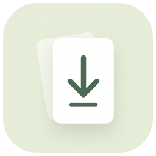

<div align="center">
  
  <h1>PDFMe</h1>
  <p><strong>Create PDFs and organize your printing.</strong></p>
  <p>A native macOS menu bar app and print queue window.<br>Finder shortcuts, saved print templates, and local processing.</p>
  <p><a href="https://github.com/justinechang39/PDFMe/releases/latest">Download</a> · <a href="#getting-started">Get started</a> · <a href="CONTRIBUTING.md">Contribute</a></p>
  <p>  </p>
</div>

## Features

- **Drop onto the menu bar icon** or the **Create PDF** panel. Click to browse, or use Finder’s **Open With → PDFMe**.
- **Desktop print queue:** group PDFs by template, adjust settings per group, preview each document, and send groups in order with per-file copies.
- **Finder shortcut:** enable PDFMe’s Finder extension for **Add to PDFMe Print Queue** directly in the right-click menu. The Services action remains available as a fallback.
- **Separate workflows:** DOCX only for Create PDF; PDF only for Print PDF. The menu bar icon routes a single-format batch to the appropriate workflow.
- **Saved beside the original** by default. Turn on **Ask every time** to choose a location for each document.
- **Small, Balanced, or Best** image quality. Text stays sharp and selectable.
- **Optional password protection.** Choose and confirm a password for each batch; it is never persisted or passed in command-line arguments.
- **Batch conversion**, honest stage-based progress, cancellation, completion notifications, and shortcuts to open or reveal results.
- **Existing files stay safe.** `Report.pdf` becomes `Report (2).pdf` if needed, even when a save dialog names an existing file.
- **Local processing.** No account, cloud upload service, or telemetry. Print through macOS or send PDF directly to your selected network printer over IPP.
- Native **SwiftUI + AppKit**, keyboard-accessible controls, and support for Reduce Motion.

## Getting started

Requires **macOS 13 or later**. DOCX conversion additionally requires [LibreOffice](https://www.libreoffice.org/download/download-libreoffice/) in `/Applications` or `~/Applications`. PDF printing needs an installed printer; LibreOffice is not needed. Direct printing uses macOS networking and an IPP printer that accepts PDF, with no additional installation.

1. For DOCX conversion, install LibreOffice (or run `brew install --cask libreoffice`). Printing PDFs does not require LibreOffice.
2. Download **PDFMe-macOS-universal.zip** from the [latest release](https://github.com/justinechang39/PDFMe/releases/latest). It runs on Apple silicon and Intel Macs.
3. Unzip and move **PDFMe.app** into Applications.
4. Open PDFMe. Its document icon appears in the menu bar. Drop a `.docx` file on it.

The initial community build is **ad-hoc signed, not Apple-notarized**. macOS may block a downloaded copy. After trying to open it, use **System Settings → Privacy & Security → Open Anyway** if you trust the release, or build from source. Do not disable Gatekeeper globally. To open PDFMe automatically when you sign in, enable **Settings → Start at login**. The toggle uses macOS Login Items and reflects changes made in System Settings. If macOS requires approval, PDFMe shows an **Open Login Items** button. Login launches stay in the menu bar without opening the panel.

Allow notifications when macOS asks if you want completion banners. Results also appear inside PDFMe regardless of notification permission. Documents from iCloud or another cloud drive must be downloaded before conversion.

## Updates

PDFMe 1.6.0 and later include [Sparkle](https://sparkle-project.org/). Install this version manually once; older versions cannot discover updates. **Automatic updates** is enabled by default and can be disabled in PDFMe’s Settings. **Check for Updates…** is also available in Settings and the application menu.

PDFMe checks GitHub for published releases, downloads updates in the background, and can install them when the app quits. An immediate update restart is blocked while converting, printing, importing, or holding unsent PDFs. Finish or clear the queue, then check again if an update was postponed. Existing preferences and saved templates are stored outside the application bundle and survive replacement. Updating does not print queued documents.

Both the update feed and download are verified with Ed25519 signatures; archives are verified before extraction. Private signing keys stay in the maintainer’s Keychain. Updates do not pull or compile source code. GitHub Actions stays disabled: releases are compiled locally and uploaded as finished downloads. Update checks contact GitHub (and its download CDN), but send no documents or Sparkle system profile. Normal network metadata such as IP address and app version remains visible to the hosting service.

The app is currently ad-hoc signed, not Apple-notarized. Sparkle signatures verify update authenticity; they do not replace Apple Developer ID signing or remove the first-install macOS approval described above.

## Print PDF

Click **Print PDF** below Create PDF, or drop one or more PDFs on that target or the menu bar icon. Dropping files opens a review; it never prints automatically. DOCX files are rejected by the print target.

1. Add the PDFs you want to print.
2. Choose a saved template and the printer. Adjust settings for this job if needed.
3. Set **Copies** on each PDF row. Drag the handle on the right to change the file order; each document’s copies stay together.
4. Click a PDF in the list to see its sheet layout on the right. Use the arrows to inspect its printed sides. **Open in Preview** opens the complete batch in macOS Preview.
5. Click **Print** to send one job to the selected printer.

After successful submission, the PDF list and its copy counts are cleared, disabling Print until you add new files. Saved templates remain available, along with the submitted job’s status and cancellation controls. Previewing or a failure before upload keeps the files for review. An uncertain direct upload also clears the batch to prevent accidental duplicates and retains its printer job number.

### Desktop Print Queue and Finder

Choose **Open Print Queue** (or the window icon) in the menu bar panel. The resizable window also appears in the Dock while open. Closing it leaves PDFMe in the menu bar; **Mini app** returns to the small panel. The first queue group shares the mini app’s documents and settings, so switching views does not duplicate files.

In Finder, select one or more PDFs and choose **Add to PDFMe Print Queue** directly from the right-click menu when the Finder extension is enabled. The same action remains under **Services** as a fallback. PDFMe launches if needed, opens its queue window, and adds the files to the selected group. **Open With → PDFMe** also opens PDFs in the queue. Neither action prints automatically. The Finder service advertises PDF support only and rejects mixed selections; unreadable, locked, or print-prohibited PDFs are reported in the app.

1. Use **Add group** to create a group from a saved template.
2. Drop PDFs on a group, or select it and choose **Add PDFs**.
3. Select a group to edit its settings on the right. Changes apply to all its documents. Saving a template updates the shared catalog; it does not overwrite another group’s current settings.
4. Set each document’s **Copies**. Drag its handle within or between groups; its menu provides the same move actions without dragging.
5. Click a document to see its composed sheet preview. **Open group in Preview** shows that group’s complete layout.
6. Choose **Print all groups**. PDFMe prepares and submits one group at a time, with one job per group. It waits for acceptance before sending the next, not for physical completion. Different groups may use different installed printers. Groups targeting the same printer are submitted in displayed order; the printer ultimately controls scheduling.

**Stop after this group** leaves future groups unsent. Accepted groups clear immediately and keep their job receipts. Any failure stops the batch; later groups remain queued. Failures before a direct PDF upload keep the group ready for a safe retry; after resolving the error, press **Print all groups** to send only the remaining documents. If a submission outcome is unknown, inspect the printer before using **Unlock for retry** or clear that group. Unlocking only enables printing; it does not send anything. A known uncertain direct job keeps its job number and clears its files. PDFMe never automatically repeats a PDF upload or switches transports.

The direct-printing toggle applies to all groups. Files, copy counts, group adjustments, and job receipts are in memory for this app session only. Closing/reopening the window keeps unsent work; quitting clears it. Saved templates persist separately. No queued work prints on launch.

To enable the top-level menu action, open PDFMe’s **Settings → Finder menu → Manage Finder Extension** and enable **PDFMe** in macOS. The app uses Apple’s extension management interface, so macOS chooses the appropriate settings page. Finder controls final placement and availability; cloud-managed folders may suppress Finder extension items. Use the Services action, Open With, or drag-and-drop in those locations.

If the Services fallback does not appear after installing, launch PDFMe once and check **System Settings → Keyboard → Keyboard Shortcuts → Services → Files and Folders** for **Add to PDFMe Print Queue**.

The Finder extension is a small, sandboxed component. It receives selection/menu callbacks and sends the selected PDF paths through a private, named pasteboard to PDFMe’s existing macOS Service. This avoids asking the sandboxed extension to open files it cannot access; the app validates and reads the PDFs under its own permissions. It does not scan folders, read PDF contents, print, or connect to the network. The main app checks the actual PDFs and opens the queue for review. It registers `/` as its Finder menu scope so local folders and mounted volumes can participate; this is not a filesystem access grant.

Implementation uses Apple’s [Finder Sync contextual menu API](https://developer.apple.com/library/archive/documentation/General/Conceptual/ExtensibilityPG/Finder.html). Finder Sync was designed primarily for sync clients; PDFMe uses only its optional menu surface and retains the standard Services route where that surface is unavailable.

### Direct PDF printing

Enable **Direct PDF printing** in Print PDF or Settings to send the composed PDF to the selected network printer using IPP/IPPS. It bypasses the Mac queue and its PDF/raster filters. Turn it off at any time to return to macOS printing; saved templates stay intact. The default remains macOS printing until you enable it.

Connect to the printer’s network and allow PDFMe access to the local network if macOS asks. Bonjour printers are resolved by service name, advertised host, port, and resource path each time you print, so a changed IP address does not require rebuilding the app. Direct printing does not support USB-only printers, legacy socket/LPD queues, printers that require HTTP authentication, or printers without native PDF and Create-Job/Send-Document support. Use macOS printing for those devices.

PDFMe checks the printer’s PDF capabilities and validates the exact settings before uploading. If the printer temporarily reports busy, stopped, or not accepting jobs, PDFMe displays **Waiting for printer…** and repeats only the read-only readiness check, up to 40 times at three-second intervals. Once ready, it creates the job and uploads the PDF once. A persistent refusal stops the batch with the printer error visible and the unsent documents retained. It does not resume paused printers, override errors, or retry job creation or uploads. Copies, ordering, blank backs, and 1/2/4-up layout are already in the prepared PDF; the printer receives **copies=1** and **number-up=1**, along with explicit paper, orientation, duplex edge, and color. Where supported, scaling is disabled for direct jobs because PDFMe has already composed the sheet with margins. Unsupported or substituted settings block upload. Printer firmware still controls physical output, so test duplex and collation on your printer before relying on this path for a large batch.

Direct jobs do not appear in the Mac queue. PDFMe retains the printer’s job number and provides **Check status** and **Cancel this job**, even after switching modes. A receipt confirms submission only. Printers may discard completed job history; missing status never means the job definitely completed. If an upload response is lost, PDFMe reports uncertainty and never automatically retries or falls back to macOS printing. Check the printer before sending the file again.

Read the [protocol design and references](docs/direct-printing.md) for implementation details.

If macOS pauses the selected printer queue, PDFMe shows the queue’s error and a **Resume printer** button. It checks every five seconds while Print PDF is open and again before submitting a job. Preview remains available while paused. Resuming requires confirmation because existing queued jobs, including partially printed ones, may start printing. Use **Printers & queues** to remove unwanted jobs first. PDFMe verifies the queue resumed; it never automatically retries documents, releases held jobs, or changes the printer’s error policy. A resumed Mac queue does not guarantee that the physical printer is ready; recurring errors may require attention on the printer itself.

### Live sheet preview

Print PDF mode expands to show the file list and settings on the left and a live preview on the right. Selecting a file highlights it and shows the sides that contain it in the actual batch. The preview includes its requested copies, blank duplex backs, and neighboring PDFs when documents share a side. Sheet numbers refer to the full print job.

Changes to paper, orientation, pages per side, image rendering, and color update the preview automatically. Rendering runs in the background and only prepares the visible side. Old renders are cancelled when selection or settings change; clearing the batch clears the preview. The preview also works before a printer is selected.

The inline preview shares the print compositor. Black-and-white vector jobs are simulated in grayscale for display; actual printer color handling and printable margins can differ. Front/back labels identify the side being shown, not an animation of the physical duplex turn. **Open in Preview** still generates the complete batch at the selected image resolution. No preview operation submits a print job.

### Templates

The first time you open printing, PDFMe creates a basic template for your system default printer. If that printer supports A4 and duplex, it also creates **A4 · 2-up duplex**: A4 landscape, two portrait pages side by side, short-edge duplex, print as image at 300 dpi. No personal printer identifiers are bundled with the app.

Use **Manage templates** (the sliders icon) to name a template, **Save** changes, **Save as new**, delete a template, or **Use as default**. Templates are stored locally and include:

- Printer and paper size (A4, Letter, A5, Legal, or A3 where supported).
- Portrait/landscape, one-sided or long-/short-edge duplex.
- One, two, or four pages per side, in left-to-right/top-to-bottom order.
- Color or black and white, where advertised by the printer driver.
- Print as image and image resolution (150, 300, or 600 dpi).
- Whether each PDF starts on a fresh physical sheet.

Unsaved setting changes affect the current job only. Copy counts are set separately for each PDF in the current job and are not stored in templates. A missing saved printer must be explicitly replaced; PDFMe does not silently redirect jobs to a different printer. Unsupported paper, color, or duplex options block submission instead of silently changing the template.

### Layout and collation

For example, with two copies of A and one copy of B, the job contains **A, A, B**, with every document’s pages in order. Copies are included in the prepared PDF, so **Open in Preview** shows the complete job. Repeated copies of a document always start on separate physical sheets. With **Start each PDF on a new sheet**, PDFMe also keeps different documents on separate sheets, adding blank backs where necessary for duplex. Turn it off to let different PDFs share a sheet. The sheet total includes all requested copies and any blank backs.

Two-up places pages side by side on each printed side; it is not booklet imposition. Landscape and short-edge duplex normally produce the expected left/right page turning for this arrangement. Printer drivers can differ, so test one sheet before a large run.

PDFMe composes the sheet layout itself with an 18-point outer margin and 12-point gap, preserving source page aspect ratios, crop boxes, rotations, and printable annotations. In macOS mode the printer fits the prepared sheet to its printable area, so the physical scale can differ slightly from the preview. Direct mode requests no extra scaling when supported. This release does not offer actual-size technical drawing output, custom margins, finishing/stapling, manual duplex, or page-range selection.

**Print as image** rasterizes each composed side at the selected resolution before spooling. This can help with PDFs whose fonts or graphics print incorrectly, but can be slower and produce larger jobs. It preserves the original files. Extremely large paper/resolution combinations are blocked with a prompt to lower resolution to limit memory usage.

### Queue status and privacy

A success notification means **submitted**, not physically printed. In macOS mode this means accepted by the system queue; in direct mode it means accepted by the printer’s IPP endpoint. The printer can still be offline, paused, out of paper, or require attention. PDFMe shows the job ID, provides a link to **Printers & queues**, and can request cancellation of its own submitted job. Sheets already printed cannot be recalled. After a timeout or an ambiguous spooler reply, PDFMe blocks another submission until you explicitly allow a retry after checking the printer queue, or clear the group.

Locked PDFs and PDFs that prohibit printing are rejected. Source PDFs are never edited. Temporary print files live in a private directory and are removed after spooling; preview files are retained for the current app session until the list is cleared or PDFMe quits. The macOS print spooler manages its own copies. A crash can leave temporary files for macOS to clean up. Saved templates contain local printer names/IDs and preferences, not the dropped files or their paths.

## Which conversion quality should I choose?

| Preset | Images | Good for |
| --- | --- | --- |
| Small | JPEG quality 75, downsample to 150 dpi | Email and everyday sharing |
| Balanced (default) | JPEG quality 90, downsample to 300 dpi | Most documents and printing |
| Best | Lossless, original resolution | Detailed images and graphics |

These settings affect images, not the resolution of text. The actual size difference depends on the source document. A text-only document may have almost the same size in every preset.

PDFMe uses LibreOffice’s Word import and PDF export engine. Complex layouts, unavailable fonts, fields, or Word-specific features can differ from Microsoft Word’s rendering. Check important documents before sharing. This is not a PDF/A, digital-signature, accessibility-certification, redaction, or permissions-management tool. Existing comments are not exported as PDF notes.

## Passwords and privacy

Password protection requires at least eight characters and matching confirmation. One password applies to the current batch only. macOS PDFKit encrypts the output; PDFMe verifies that it is locked and can be reopened with the supplied password before publishing it. It does not claim a particular encryption algorithm across macOS versions. Passwords are not written to preferences, logs, or process arguments; they exist in memory for the batch. Swift strings do not guarantee cryptographic memory erasure.

Conversion uses a private temporary workspace and isolated LibreOffice profile, with macros and automatic linked-content updates disabled. Temporary copies are removed after success, failure, or cancellation. A force quit or machine crash can leave temporary files for macOS to clean up; cleanup is not secure disk erasure. LibreOffice runs with your user permissions and is a separately installed dependency, not a security sandbox. DOCX conversion makes no network requests from PDFMe; printing explicitly submits to your chosen printer through macOS or directly over IPP; untrusted documents should always be treated with care.

Recent results are in memory only and disappear when PDFMe quits. Quality, protection, save-location preferences, and print templates persist. Output files receive owner-only file permissions; originals are never edited. Completed PDFs remain after cancelling a batch.

## Build from source

Builds run locally. GitHub Actions is disabled for this repository and the build workflow has been removed; pushes and pull requests do not start GitHub builds. Releases can be built and uploaded manually.

Requires macOS 13 or later and Apple Command Line Tools. The commands below were verified on Apple silicon with Swift 6.2, Python 3.11.6, and LibreOffice 26.2.3.2. Swift Package Manager downloads the pinned Sparkle 2.10.0 binary package and verifies its checksum; the resolved dependency is committed. An internet connection is required on the first build. Install Command Line Tools with `xcode-select --install` if needed, then verify the selected tools:

```sh
xcode-select -p
swift --version
```

LibreOffice is needed for DOCX conversion and its tests, but not for building PDFMe or testing PDF printing. The standalone test scripts also require Python 3 (`python3 --version`).

```sh
git clone https://github.com/justinechang39/PDFMe.git
cd PDFMe
./scripts/build.sh
/usr/bin/codesign --verify --deep --strict --verbose=2 dist/PDFMe.app
```

The script compiles and embeds `PDFMeFinder.appex` and Sparkle, preserving framework symlinks and signing nested components before the containing app. It makes `dist/PDFMe.app` and `dist/PDFMe-macOS-$(uname -m).zip` for the current Mac’s architecture, then ad-hoc signs the app. Use `PDFME_ARCHS="arm64 x86_64" ./scripts/build.sh` to make the universal release ZIP. Set `CODE_SIGN_IDENTITY` to your own signing identity if you maintain a distribution build. Developer ID signing, hardened runtime, and notarization are release-maintainer responsibilities and are not configured by this script.

### Publish a locally built release

Release maintainers need `gh` authenticated for this repository and the signing key in their login Keychain under the Sparkle account `io.github.justinechang39.PDFMe`. Preserve a secure backup of that key; losing it can prevent existing installations from accepting future updates. Do not export it into this repository or publish it. Forks must generate their own key, replace `SUPublicEDKey`/`SUFeedURL`, and use their own release repository and signing account.

1. Increment the app and Finder extension version/build numbers together. Add release notes, run the local checks, and commit to `main`.
2. Run `./scripts/release.py prepare --notes path/to/release-notes.md`. This builds both architectures locally, checks that the Keychain public key matches the app, signs the archive/feed with Sparkle, and writes checksums plus the source commit under ignored `dist/releases/vVERSION/`.
3. Push `main`, then run `./scripts/release.py publish`. It requires a clean checkout, unchanged artifacts, the matching remote commit, and disabled GitHub Actions. It uploads all assets to a draft release before publishing it as latest. It does not run any workflow.

The app checks `https://github.com/justinechang39/PDFMe/releases/latest/download/appcast.xml`; each signed feed points to its version-specific ZIP. Publish new versioned releases; do not replace existing release assets. Source-code ZIPs generated by GitHub are not installers.

### Install a local build

If PDFMe is running, choose **Quit PDFMe** from its panel before replacing the app. From the repository directory:

```sh
/usr/bin/ditto dist/PDFMe.app /Applications/PDFMe.app
/usr/bin/codesign --verify --deep --strict --verbose=2 /Applications/PDFMe.app
/Applications/PDFMe.app/Contents/MacOS/PDFMe --print-transport-status
/System/Library/Frameworks/CoreServices.framework/Frameworks/LaunchServices.framework/Support/lsregister -f /Applications/PDFMe.app
open /Applications/PDFMe.app
```

Replacing the bundle preserves saved templates and preferences, which are stored separately. The status command only reads the printing preference; it does not start the UI or send a print job. The copy, signature, status, and Launch Services registration commands have been verified locally. PDFMe registers its Finder service when it launches. After installing a build with the Finder extension, enable PDFMe through its **Manage Finder Extension** button; registering the app alone does not establish that Finder has enabled or loaded the extension. Opening the installed app shows its icon in the menu bar. Use **Settings → Start at login** if desired, and allow local-network access if macOS asks when using direct printing.

### Test the updater (release maintainer)

After building, run `python3 scripts/test-updates.py`. It requires the release-signing key in Keychain and may prompt locally for access by `generate_appcast` or `sign_update`. It checks the actual app updater configuration and work-protection delegates, then serves signed test updates over loopback to isolated dummy applications. It verifies successful installation and rejection of a modified archive or feed. It never updates the installed PDFMe or sends a print job. Logs/fixtures stay in ignored `work/`.

### Test locally

```sh
# Real conversion, encryption, cancellation, and file-safety checks:
./scripts/test.sh

# Print layout, queue sequencing, Finder service, and simulated printer checks; prints no paper:
./scripts/test-print.sh

# Finder extension menu selection and action checks; opens no files:
./scripts/test-finder.sh

# Real sandbox-to-Service transfer, using isolated synthetic PDFs and a test app:
python3 scripts/test-finder-sandbox.py

# XCTest suite (requires full Xcode selected and licensed):
swift test
```

`scripts/test.sh` requires LibreOffice in `/Applications` or `~/Applications`. `scripts/test-print.sh` does not need LibreOffice; it uses Swift, Python 3, and the built-in macOS printing tools. Both scripts work with Command Line Tools alone and generate fixtures under ignored `work/`. Print checks submit only to simulated IPP endpoints and never require or send jobs to a physical printer. Queue checks exercise real composition with a mock submission handler, serialized imports, independent group settings, per-file copy counts, sequential uploads, printer backpressure between groups, safe retries after preflight failures, partial failures, uncertain jobs, stopping, and Finder pasteboards.

`test-finder-sandbox.py` temporarily registers a separate receiver app in `~/Applications`, then removes it. It uses the production handoff and service parser with the extension’s actual sandbox entitlements. It verifies that the sender cannot read the PDFs, but the receiver gets both paths in order and can open the documents. The test does not contact PDFMe’s queue or a printer. Generated test fixtures remain under ignored `work/`.

`swift test` additionally requires full Xcode selected and licensed; Command Line Tools alone may report a missing XCTest module. Conversion XCTest cases skip when LibreOffice is absent. Do not change the selected developer directory just to run the standalone scripts.

## How it works

`PDFMe` owns the menu bar, native drop target, SwiftUI panel, queue, save dialogs, and notifications. `PDFMeCore` validates DOCX packages, runs LibreOffice asynchronously with a two-minute timeout, checks the resulting PDF, optionally applies password protection using PDFKit, and stages the final file on the destination volume. An atomic exclusive hard link publishes it without overwriting a file, including a concurrent naming collision. Destinations must support hard links (the usual macOS APFS/HFS+ disks do); unsupported volumes produce an error instead of risking replacement.

Printing uses PDFKit/Core Graphics for composition and the macOS `lpstat`, `lpoptions`, `lp`, and `cancel` tools with argument arrays rather than shell commands. N-up and per-file copy counts are applied during composition, and the complete prepared PDF is submitted exactly once with explicit print options. Printer defaults are queried but never changed.

See [LibreOffice’s PDF export parameters](https://help.libreoffice.org/latest/en-US/text/shared/guide/pdf_params.html) for the image-quality settings used by the app.

## Open source

[MIT licensed](LICENSE), copyright © 2026 Justine Chang. Contributions and [issues](https://github.com/justinechang39/PDFMe/issues) are welcome. See [CONTRIBUTING.md](CONTRIBUTING.md), [SECURITY.md](SECURITY.md), and [THIRD_PARTY_NOTICES.md](THIRD_PARTY_NOTICES.md).
